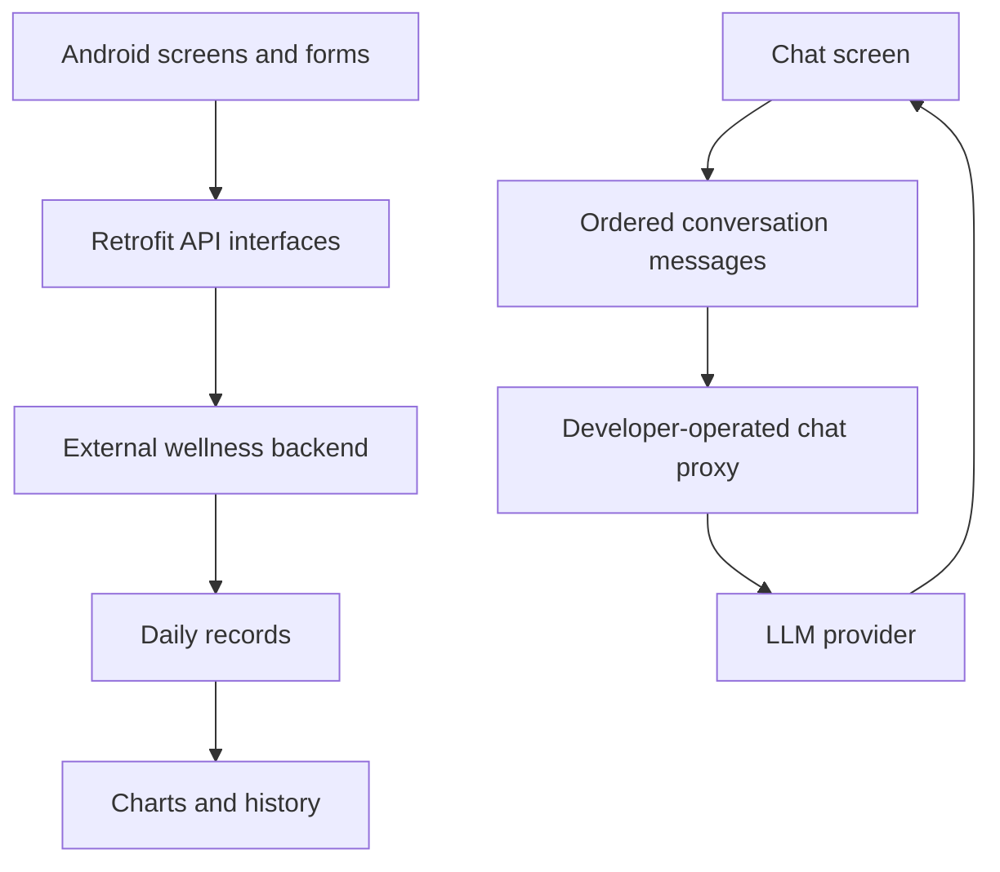

<div align="center">


# CalmCloud

**An Android companion for reflecting on mood, sleep, and stress.**

A Kotlin application combining daily wellness check-ins, visual summaries, and an optional conversational interface.

[](https://github.com/jimmy19981226/CalmCloud/actions/workflows/ci.yml)


[Review guide](#review-guide) · [Features](#experience) · [Architecture](#architecture) · [Setup](#build-and-run) · [API contract](docs/API_CONTRACT.md) · [Tests](#verification)

</div>

## Experience

CalmCloud explores how structured self-reporting and a conversational interface can fit into a simple mobile workflow. Users can record daily observations, review visual summaries, and open a chat screen from the main application.

| Track | Reflect | Converse |
| :--- | :--- | :--- |
| Mood selection, sleep times and quality, stress levels | Mood/stress charts and a sleep history list | Conversation history sent to a configured chat-completions proxy |

**Repository scope:** This repository contains the Android client. Its REST backend and chat proxy are separate dependencies and are **not bundled**. The client can be built independently; login, persistence, and chat require compatible services. This is a learning/prototype project for self-reflection, with no clinical validation.

## Review guide

Start with the [API contract](docs/API_CONTRACT.md) to see the client/backend boundary, then follow [ChatBotActivity.kt](app/src/main/java/com/example/calmcloud/subpage/chatbot/ChatBotActivity.kt) → [ChatRequests.kt](app/src/main/java/com/example/calmcloud/subpage/chatbot/ChatRequests.kt) → [request tests](app/src/test/java/com/example/calmcloud/subpage/chatbot/ChatRequestsTest.kt).

A concrete regression case: for the conversation `user: Hello → assistant: Welcome → user: Thanks`, the outgoing request must preserve all three messages in order and include the newest message once. The request builder is a pure mapping that can be tested without an emulator, backend, or model credential.

| Decision | Benefit and current tradeoff |
| :--- | :--- |
| Keep request construction separate from the activity | Message ordering and roles can be checked in JVM tests; screen lifecycle still needs device-level validation. |
| Disable send during a request and cancel on activity destruction | Prevents overlapping submissions and callbacks into a destroyed screen; conversation state remains in memory. |
| Configure a developer-operated chat proxy | Provider credentials stay outside the APK; proxy authentication is still an integration requirement. |

**Try without backend services:** follow [build setup](#build-and-run), then run `bash ./gradlew testDebugUnitTest`. A complete mood-entry or chat demo requires the external services described below.

## Architecture



| Layer | Technology and responsibility |
| :--- | :--- |
| UI | Kotlin activities/fragments, XML layouts, Material components, RecyclerView |
| Network | Retrofit, Gson, OkHttp, typed request/response models |
| Visualization | MPAndroidChart for mood and stress summaries |
| AI integration | Chat-completions request contract, ordered conversation context, configurable proxy/model |
| Build | Gradle Kotlin DSL, version catalog, JUnit, GitHub Actions |

Service errors are displayed separately from model conversation history. Request-body logging is disabled so wellness entries and chat text are not written into HTTP logs.

## Build and run

### 1. Open the project

Requirements: **JDK 17**, Android SDK **34**, and a compatible Android Studio installation. The Gradle wrapper uses **8.6**; the Android Gradle Plugin is **8.4.1**.

```bash
git clone https://github.com/jimmy19981226/CalmCloud.git
cd CalmCloud
bash ./gradlew assembleDebug
```

Open the root directory in Android Studio, let Gradle sync, select an emulator/device running Android 7.0 (API 24) or later, and run the `app` target. Configure the SDK location through Android Studio or your local `local.properties` file.

### 2. Connect the wellness backend

The default API URL is `http://10.0.2.2:3000/`, which points from the Android emulator to port 3000 on its host. The backend must implement the [documented endpoint and JSON contract](docs/API_CONTRACT.md).

Override the endpoint at build time:

```bash
bash ./gradlew assembleDebug \
  -PCALMCLOUD_API_BASE_URL=https://your-backend.example/
```

For a physical device, use a reachable HTTPS backend. The existing network policy permits cleartext traffic only to the emulator host `10.0.2.2`.

### 3. Configure optional chat

Set the URL of a proxy you operate that implements `POST /v1/chat/completions`:

```bash
bash ./gradlew assembleDebug \
  -PCALMCLOUD_API_BASE_URL=https://your-backend.example/ \
  -PCALMCLOUD_CHAT_BASE_URL=https://your-chat-proxy.example/ \
  -PCALMCLOUD_CHAT_MODEL=your-provider-model-id
```

The proxy attaches its provider credential on the server. Endpoint URLs and model IDs are build configuration; API keys should never be placed in the app or committed. An unconfigured chat screen reports that setup is required instead of sending a request with an empty bearer credential.

The prototype does not implement authenticated access to the chat proxy. Use it in a controlled development environment until the backend and client implement appropriate user authentication and abuse controls.

## Code guide

| Entry point | Responsibility |
| :--- | :--- |
| [`MainActivity.kt`](app/src/main/java/com/example/calmcloud/MainActivity.kt) | Main navigation |
| [`subpage/`](app/src/main/java/com/example/calmcloud/subpage/) | Mood, sleep, stress, and visualization screens |
| [`ChatBotActivity.kt`](app/src/main/java/com/example/calmcloud/subpage/chatbot/ChatBotActivity.kt) | Conversation UI and network-call lifecycle |
| [`ChatRequests.kt`](app/src/main/java/com/example/calmcloud/subpage/chatbot/ChatRequests.kt) | Testable conversation-to-request mapping |
| [`ApiService.kt`](app/src/main/java/com/example/calmcloud/api/ApiService.kt) | Backend contracts |
| [`RetrofitClient.kt`](app/src/main/java/com/example/calmcloud/api/RetrofitClient.kt) | Configurable clients, timeouts, logging policy |

The standalone [`lab1_pytorch_intro.ipynb`](lab1_pytorch_intro.ipynb) is a supplementary learning notebook. The application itself is implemented in Kotlin.

## Verification

```bash
bash ./gradlew testDebugUnitTest assembleDebug lintDebug
```

The JVM tests cover chat message ordering, role preservation, rejection of empty conversations, and the duplicate-message regression. Android CI compiles the debug app, runs JVM tests, and runs Android lint without requiring backend credentials. Device integration and backend behavior require separately configured services.

## Current boundaries and next steps

- Backend source, persistence, authorization, and deployment are outside this repository. The login screen currently consumes the external service's response without storing a session token.
- Chat history lives in the activity's memory and does not survive process death. A ViewModel and persisted conversation store would improve lifecycle handling.
- Daily-entry deduplication currently starts with a client-side lookup; concurrent requests need server-side uniqueness rules.
- Device screenshots, end-to-end tests with a controlled backend, and accessibility testing would be useful next validation steps.

Contributions should preserve the mood/sleep/stress workflow, keep credentials server-side, and include a focused regression test for changed behavior. See the [API contract](docs/API_CONTRACT.md) before changing data models.
